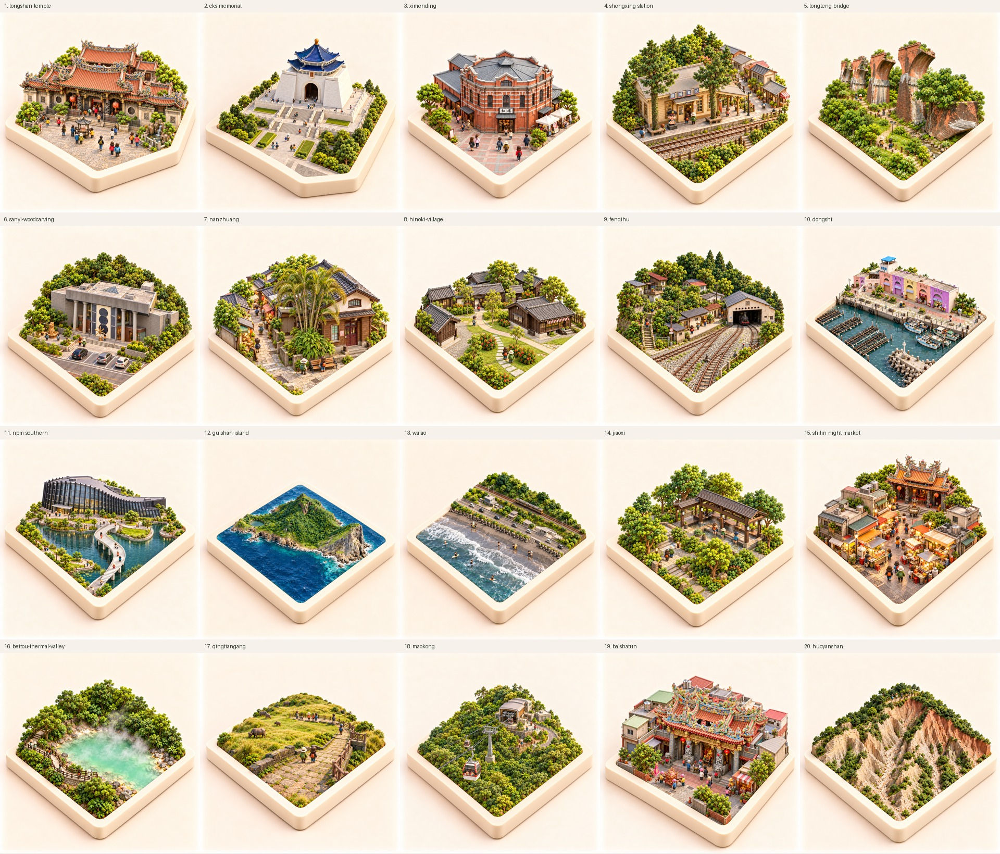

# 新景點模型審查：第 2 批（2026-10-15）

本批新增 20 個景點、20 張選定預覽；龜山島另修正一次，共生成 21 張。比較頁現在有 45 個景點可對照。

[從本批第一張開始比較](asset-comparison.html#longshan-temple)

總覽使用原色縮圖；比較頁預設採可還原的 88% 顯示鮮豔度。原始 PNG 為正方形、每邊至少 1024px，未放大。

## 審查狀態

已自檢方形圓角象牙基座、場景收於底座、無背景板、模型材質與 512px 辨識。真實地理、精確比例、未拍清楚的背面與使用者逐張核准仍待確認。這批為審查預覽，正式 App 的 master/day/thumbnail/token 與 src 未變更。

每個景點都有真實照片與衛星圖，但部分外部街景／360° 視角仍待補。火炎山現有 360° 為空拍，不能視為地面街景。龜山島 v1 的中央山體過平、西側湖泊變海灣，列為問題版；目前選 v2，以官方完整島體照片補正。

| Spot | Selected preview | Review notes |
|---|---|---|
| 艋舺龍山寺 (`longshan-temple`) | [review-v1.png](../assets/spots/longshan-temple/collection/review-v1.png) | 2026-10-15 review-v1.png, new collection preview only. Front hall roof/dragon columns and south-facing entrance compared with real panorama and satellite. Rear roof massing and waterfall scale are simplified, not measured. User approval pending; formal runtime assets and tokens unchanged. Source acquisition dates are recorded where visible; satellite acquisition dates unavailable. Presentation self-check: coherent square ivory plinth, no boards/hardware, complete visible footprint and miniature material finish; main subject remains legible at 512px. Geographic identity and user acceptance still pending. |
| 中正紀念堂 (`cks-memorial`) | [review-v1.png](../assets/spots/cks-memorial/collection/review-v1.png) | 2026-10-15 review-v1.png, new collection preview only. Square white body corrected from draft’s octagonal-body error; blue octagonal roof and west-facing stairs retained. Exact roof facets, facade proportions and 89 individual stair treads require manual review. User approval pending; formal runtime assets and tokens unchanged. Source acquisition dates are recorded where visible; satellite acquisition dates unavailable. Presentation self-check: coherent square ivory plinth, no boards/hardware, complete visible footprint and miniature material finish; main subject remains legible at 512px. Geographic identity and user acceptance still pending. |
| 西門町 (`ximending`) | [review-v1.png](../assets/spots/ximending/collection/review-v1.png) | 2026-10-15 review-v1.png, new collection preview only. Real exterior photo replaces panorama facing away. Octagonal facade and cruciform west wing checked; rear details and neighboring stalls simplified. Exterior Street View/360 audit remains pending. User approval pending; formal runtime assets and tokens unchanged. Source acquisition dates are recorded where visible; satellite acquisition dates unavailable. Presentation self-check: coherent square ivory plinth, no boards/hardware, complete visible footprint and miniature material finish; main subject remains legible at 512px. Geographic identity and user acceptance still pending. |
| 勝興車站 (`shengxing-station`) | [review-v1.png](../assets/spots/shengxing-station/collection/review-v1.png) | 2026-10-15 review-v1.png, new collection preview only. Official Tourism Administration facade photograph plus satellite plan used. Default panorama failed to load and is excluded; usable station-exterior Street View audit remains pending. Rail count/platform details require review. User approval pending; formal runtime assets and tokens unchanged. Source acquisition dates are recorded where visible; satellite acquisition dates unavailable. Presentation self-check: coherent square ivory plinth, no boards/hardware, complete visible footprint and miniature material finish; main subject remains legible at 512px. Geographic identity and user acceptance still pending. |
| 龍騰斷橋 (`longteng-bridge`) | [review-v1.png](../assets/spots/longteng-bridge/collection/review-v1.png) | 2026-10-15 review-v1.png, new collection preview only. Broken arch shoulders and freestanding redbrick piers retained; no intact deck. Exact surviving pier count, bridge-axis angle and valley-channel position require manual review. User approval pending; formal runtime assets and tokens unchanged. Source acquisition dates are recorded where visible; satellite acquisition dates unavailable. Presentation self-check: coherent square ivory plinth, no boards/hardware, complete visible footprint and miniature material finish; main subject remains legible at 512px. Geographic identity and user acceptance still pending. |
| 三義木雕老街 (`sanyi-woodcarving`) | [review-v1.png](../assets/spots/sanyi-woodcarving/collection/review-v1.png) | 2026-10-15 review-v1.png, new collection preview only. Corrected wooden-oldstreet draft to actual concrete museum, four entrance columns and three facade disks. Separate Shuimei street excluded. Public exterior photo replaces default interior panorama; exterior 360 audit and unseen roof/side-wing details remain pending. User approval pending; formal runtime assets and tokens unchanged. Source acquisition dates are recorded where visible; satellite acquisition dates unavailable. Presentation self-check: coherent square ivory plinth, no boards/hardware, complete visible footprint and miniature material finish; main subject remains legible at 512px. Geographic identity and user acceptance still pending. |
| 南庄老街 (`nanzhuang`) | [review-v1.png](../assets/spots/nanzhuang/collection/review-v1.png) | 2026-10-15 review-v1.png, new collection preview only. Timber post office, pale upper gable and entry-side palms checked. No fictional stream through this crop. Exact alley shop arrangement and rear roof geometry remain simplified. User approval pending; formal runtime assets and tokens unchanged. Source acquisition dates are recorded where visible; satellite acquisition dates unavailable. Presentation self-check: coherent square ivory plinth, no boards/hardware, complete visible footprint and miniature material finish; main subject remains legible at 512px. Geographic identity and user acceptance still pending. |
| 檜意森活村 (`hinoki-village`) | [review-v1.png](../assets/spots/hinoki-village/collection/review-v1.png) | 2026-10-15 review-v1.png, new collection preview only. Real timber-house ground panorama and satellite garden cluster compared. Houses are a representative compact crop; exact dormitory identities and footprints remain pending. User approval pending; formal runtime assets and tokens unchanged. Source acquisition dates are recorded where visible; satellite acquisition dates unavailable. Presentation self-check: coherent square ivory plinth, no boards/hardware, complete visible footprint and miniature material finish; main subject remains legible at 512px. Geographic identity and user acceptance still pending. |
| 奮起湖 (`fenqihu`) | [review-v1.png](../assets/spots/fenqihu/collection/review-v1.png) | 2026-10-15 review-v1.png, new collection preview only. Real engine-shed photo and satellite track/old-street relationship used. Exact station/garage architecture, switch count and tree species require manual review; no operating locomotive invented. User approval pending; formal runtime assets and tokens unchanged. Source acquisition dates are recorded where visible; satellite acquisition dates unavailable. Presentation self-check: coherent square ivory plinth, no boards/hardware, complete visible footprint and miniature material finish; main subject remains legible at 512px. Geographic identity and user acceptance still pending. |
| 東石漁人碼頭 (`dongshi`) | [review-v1.png](../assets/spots/dongshi/collection/review-v1.png) | 2026-10-15 review-v1.png, new collection preview only. Actual pastel arcaded shop facade and satellite harbor/oyster-bed arrangement used. Forecourt panorama reviewed but lacked water; selected new photo adds facade evidence. Rack spacing and crop compression are approximate. User approval pending; formal runtime assets and tokens unchanged. Source acquisition dates are recorded where visible; satellite acquisition dates unavailable. Presentation self-check: coherent square ivory plinth, no boards/hardware, complete visible footprint and miniature material finish; main subject remains legible at 512px. Geographic identity and user acceptance still pending. |
| 故宮南院 (`npm-southern`) | [review-v1.png](../assets/spots/npm-southern/collection/review-v1.png) | 2026-10-15 review-v1.png, new collection preview only. Draft zigzag bridge corrected to flowing curved Zhimei Bridge. Real glass/vertical-fin facade and satellite lake/bridge relationship used. Full roof shape, bridge structure and exact bank geometry remain pending. User approval pending; formal runtime assets and tokens unchanged. Source acquisition dates are recorded where visible; satellite acquisition dates unavailable. Presentation self-check: coherent square ivory plinth, no boards/hardware, complete visible footprint and miniature material finish; main subject remains legible at 512px. Geographic identity and user acceptance still pending. |
| 龜山島 (`guishan-island`) | [review-v2.png](../assets/spots/guishan-island/collection/review-v2.png) | 2026-10-15 review-v1.png, new collection preview only. Seaward head cliff, summit head view and whole-island satellite cross-checked. Island elevations, western harbor and lagoon proportions are approximate; not a surveyed island model. User approval pending; formal runtime assets and tokens unchanged. Source acquisition dates are recorded where visible; satellite acquisition dates unavailable. First review-v1 is rejected for flattened central body and an open sea bay replacing the western lagoon. review-v2 requested using official complete-island profile as primary elevation evidence. Presentation self-check: coherent square ivory plinth, no boards/hardware, complete visible footprint and miniature material finish; main subject remains legible at 512px. Geographic identity and user acceptance still pending. review-v2.png selected: restored higher central wooded body and separate lower eastern head, small enclosed western lagoon, using official complete-island photograph; precise elevations/coastline still approximate. |
| 外澳沙灘 (`waiao`) | [review-v1.png](../assets/spots/waiao/collection/review-v1.png) | 2026-10-15 review-v1.png, new collection preview only. Grey-black sand, surf and coast-road/rail/hill sequence checked. Distant Guishan omitted rather than moved adjacent. Beach width, shoreline armoring and transport details require manual geographic review. User approval pending; formal runtime assets and tokens unchanged. Source acquisition dates are recorded where visible; satellite acquisition dates unavailable. Presentation self-check: coherent square ivory plinth, no boards/hardware, complete visible footprint and miniature material finish; main subject remains legible at 512px. Geographic identity and user acceptance still pending. |
| 礁溪溫泉 (`jiaoxi`) | [review-v1.png](../assets/spots/jiaoxi/collection/review-v1.png) | 2026-10-15 review-v1.png, new collection preview only. Actual covered footbath timber pavilion and wooded park satellite used. Canopy hides exact pool/building plan; modeled footbath visibility and layout require review. User approval pending; formal runtime assets and tokens unchanged. Source acquisition dates are recorded where visible; satellite acquisition dates unavailable. Presentation self-check: coherent square ivory plinth, no boards/hardware, complete visible footprint and miniature material finish; main subject remains legible at 512px. Geographic identity and user acceptance still pending. |
| 士林夜市 (`shilin-night-market`) | [review-v1.png](../assets/spots/shilin-night-market/collection/review-v1.png) | 2026-10-15 review-v1.png, new collection preview only. Real Cixian Temple facade plus satellite lanes used; temple corrected to north of lanes. Surrounding stall/shop details are generalized, not traced individual businesses. Original 360 glimpse partial; complete lane-level audit remains pending. User approval pending; formal runtime assets and tokens unchanged. Source acquisition dates are recorded where visible; satellite acquisition dates unavailable. Presentation self-check: coherent square ivory plinth, no boards/hardware, complete visible footprint and miniature material finish; main subject remains legible at 512px. Geographic identity and user acceptance still pending. |
| 北投地熱谷 (`beitou-thermal-valley`) | [review-v1.png](../assets/spots/beitou-thermal-valley/collection/review-v1.png) | 2026-10-15 review-v1.png, new collection preview only. Actual jade pond, steam, rock bank and wooded satellite valley checked. Visitors stay on rail walkway; no bathers. Exact shore contour and entrance path under canopy remain pending. User approval pending; formal runtime assets and tokens unchanged. Source acquisition dates are recorded where visible; satellite acquisition dates unavailable. Presentation self-check: coherent square ivory plinth, no boards/hardware, complete visible footprint and miniature material finish; main subject remains legible at 512px. Geographic identity and user acceptance still pending. |
| 擎天崗 (`qingtiangang`) | [review-v1.png](../assets/spots/qingtiangang/collection/review-v1.png) | 2026-10-15 review-v1.png, new collection preview only. Open grassy terrain, path/fence and satellite trail network checked. Buffalo and hikers are scale cues; exact trail section, grazing positions and grass species remain interpretive. User approval pending; formal runtime assets and tokens unchanged. Source acquisition dates are recorded where visible; satellite acquisition dates unavailable. Presentation self-check: coherent square ivory plinth, no boards/hardware, complete visible footprint and miniature material finish; main subject remains legible at 512px. Geographic identity and user acceptance still pending. |
| 貓空纜車 (`maokong`) | [review-v1.png](../assets/spots/maokong/collection/review-v1.png) | 2026-10-15 review-v1.png, new collection preview only. Actual enclosed cabins and cable corridor photo plus upper-station satellite used. Default 360 showed unrelated tea patio and is rejected. Station exterior/360 remains pending; no unverified adjacent tea terrace added. User approval pending; formal runtime assets and tokens unchanged. Source acquisition dates are recorded where visible; satellite acquisition dates unavailable. Presentation self-check: coherent square ivory plinth, no boards/hardware, complete visible footprint and miniature material finish; main subject remains legible at 512px. Geographic identity and user acceptance still pending. |
| 白沙屯拱天宮 (`baishatun`) | [review-v1.png](../assets/spots/baishatun/collection/review-v1.png) | 2026-10-15 review-v1.png, new collection preview only. Actual temple facade plus satellite small Gongtian roof cluster used, distinguishing adjacent larger Tiande Temple. Default interior panorama replaced by public exterior photo; exterior 360 audit, rear halls and exact approach remain pending. User approval pending; formal runtime assets and tokens unchanged. Source acquisition dates are recorded where visible; satellite acquisition dates unavailable. Presentation self-check: coherent square ivory plinth, no boards/hardware, complete visible footprint and miniature material finish; main subject remains legible at 512px. Geographic identity and user acceptance still pending. |
| 火炎山 (`huoyanshan`) | [review-v1.png](../assets/spots/huoyanshan/collection/review-v1.png) | 2026-10-15 review-v1.png, new collection preview only. Real drone360 and satellite actual badlands used. Gravel/conglomerate texture and dry gullies retained. Drone image is aerial, not street-level: ground viewpoint remains pending; exact ridge elevations and scale unmeasured. User approval pending; formal runtime assets and tokens unchanged. Source acquisition dates are recorded where visible; satellite acquisition dates unavailable. Presentation self-check: coherent square ivory plinth, no boards/hardware, complete visible footprint and miniature material finish; main subject remains legible at 512px. Geographic identity and user acceptance still pending. |

Exact prompts: per-spot collection/review-vN-prompt.txt and docs/cute-diorama-prompts.json. Builder inputs are saved as review-v1-blueprint-brief.txt. Sources, credits, visible capture dates and limitations: per-spot reference/sources.json.

## Validation

lint, typecheck and spots:check pass. assets:check: 159 spots / 0 errors / 517 warnings for unfinished drafts and preview-only runtime assets. Four isolated validator cases passed: valid selected full-size preview accepted; missing selection rejected; approved without day rejected; draft accepted.
